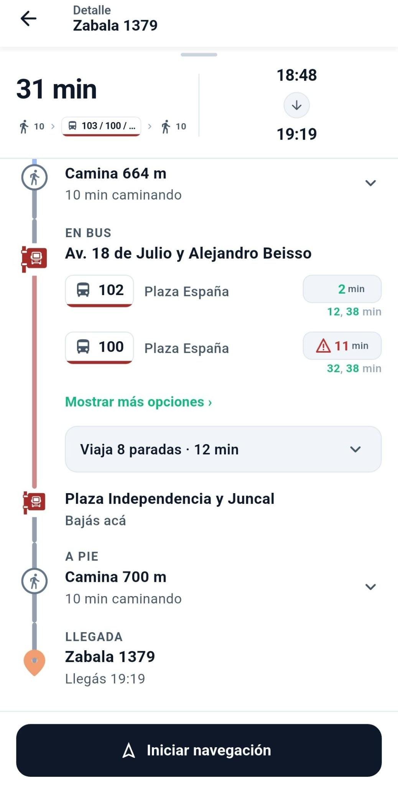
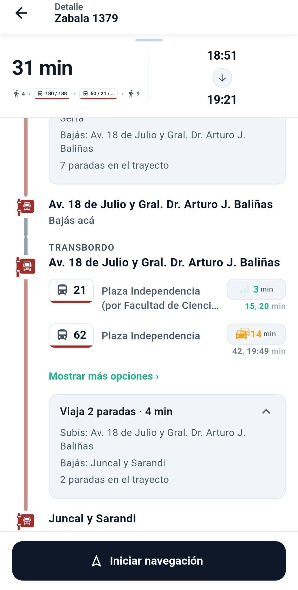
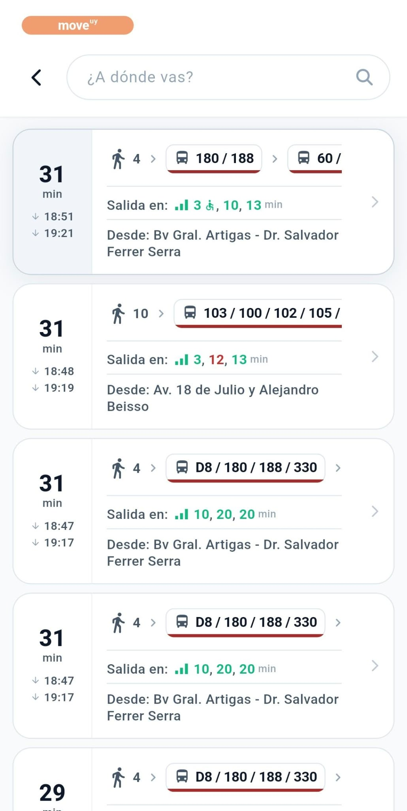
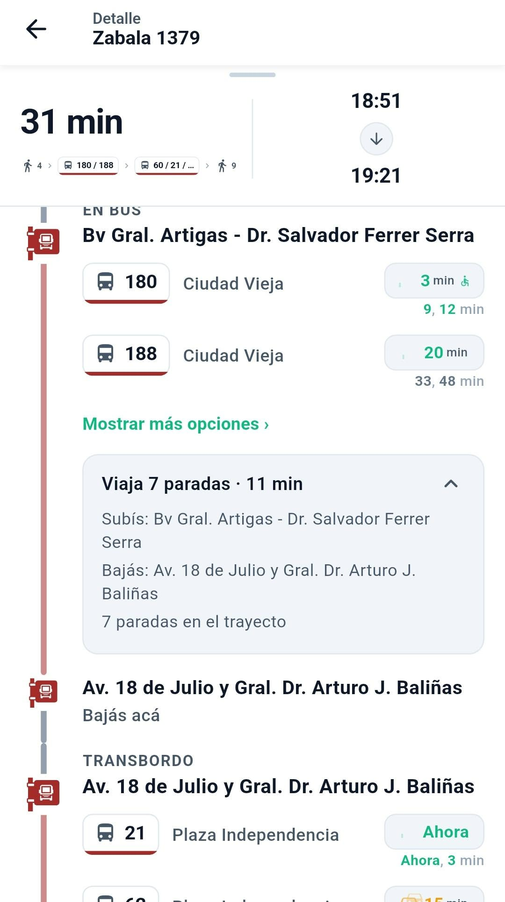
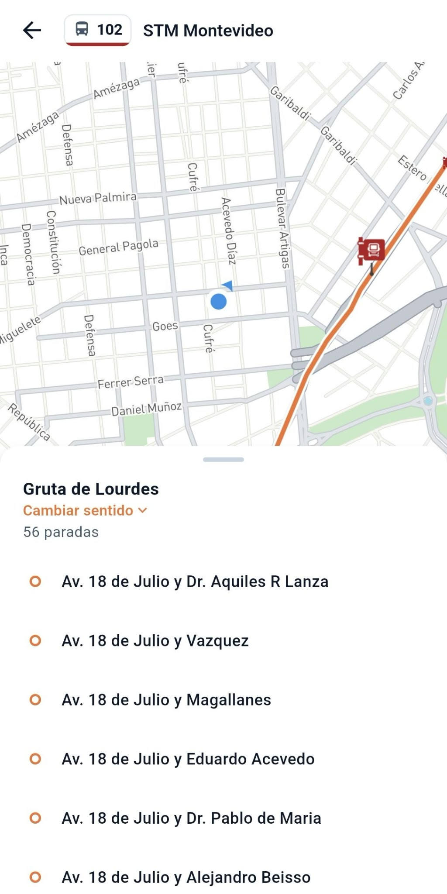
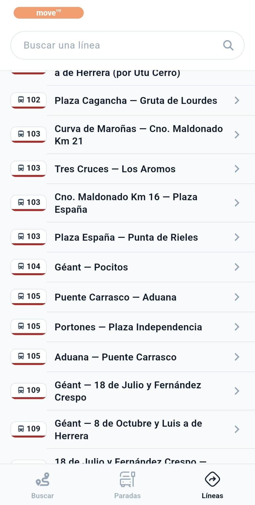
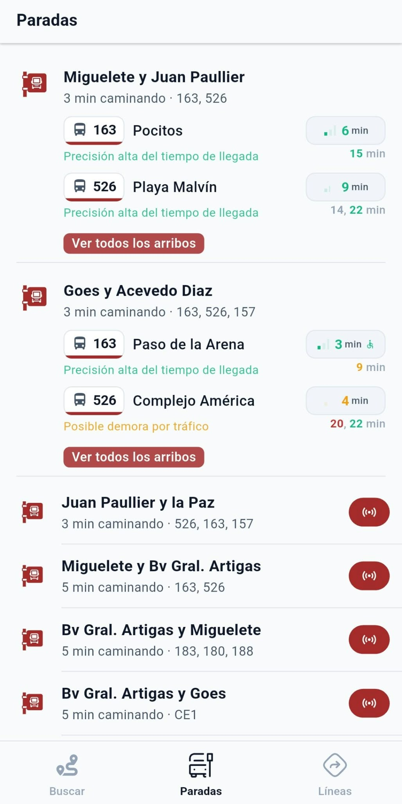
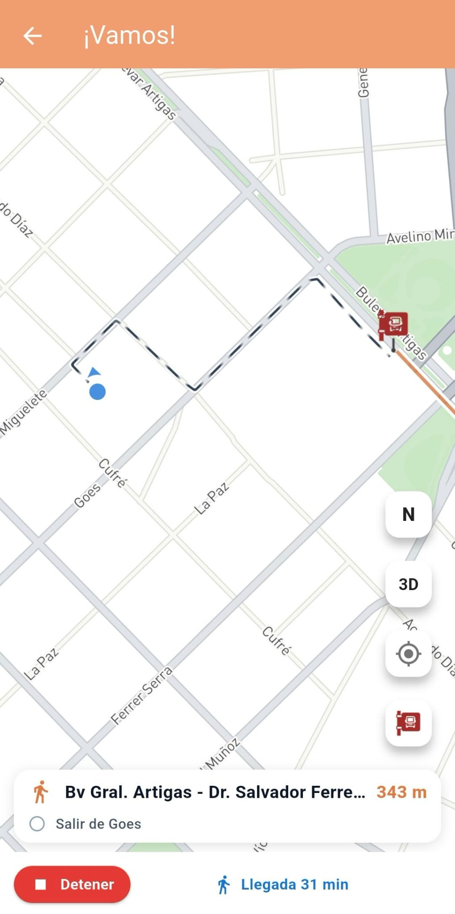
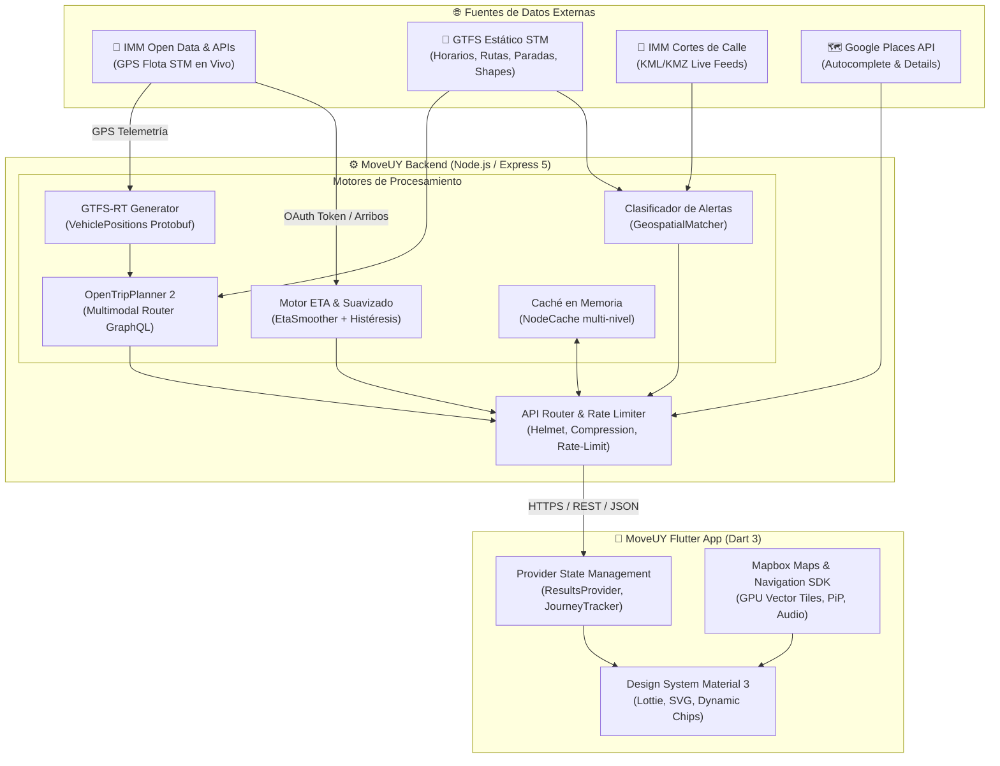

# 🚌 MoveUY — Plataforma Inteligente de Transporte Público en Tiempo Real

<p align="center">
  
</p>

<p align="center">
  <strong>Sistema integral de movilidad urbana para el Sistema de Transporte Metropolitano (STM) de Montevideo, Uruguay.</strong><br>
  Combina telemetría GPS en tiempo real de la flota, OpenTripPlanner 2 para ruteo multimodal, procesamiento geoespacial con GTFS/GTFS-RT y una interfaz móvil de alto rendimiento desarrollada en Flutter.
</p>

<p align="center">
  <a href="https://api.moveuy.com/docs"></a>
  
  
  
  
  
  
</p>

---

> [!NOTE]
> ### 🏛️ Vitrina Técnica y Estudio de Arquitectura (*Showcase Repo*)
> Este repositorio constituye la **vitrina pública, especificación de arquitectura y documentación técnica** del ecosistema MoveUY.
> Para proteger la propiedad intelectual y los algoritmos propietarios de cálculo telemétrico, el código fuente completo del backend y de la aplicación móvil se mantiene en un repositorio privado. La **demostración técnica en vivo del código y arquitectura** se encuentra disponible a solicitud durante procesos de selección técnica o entrevistas.

---

## 📌 Tabla de Contenidos
1. [Descripción General](#-descripción-general)
2. [Capturas de la Aplicación (UI / UX Showcase)](#-capturas-de-la-aplicación-ui--ux-showcase)
3. [Arquitectura del Sistema](#-arquitectura-del-sistema)
4. [Documentación de la API Backend](#-documentación-de-la-api-backend)
   - [Documentación Interactiva en Vivo](#documentación-interactiva-en-vivo)
   - [Motor de Alertas y Clasificación de Tráfico](#motor-de-alertas-y-clasificación-de-tráfico-alerttype)
   - [Niveles de Precisión GPS](#niveles-de-precisión-gps-gpsaccuracy)
   - [Endpoints Principales](#endpoints-principales)
   - [Seguridad y Rate Limiting](#seguridad-resiliencia-y-rate-limiting)
5. [Estructura del Proyecto (Monorepo)](#-estructura-del-proyecto-monorepo)
6. [Autor y Contacto](#autor-y-contacto)

---

## 🌟 Descripción General

**MoveUY** es una solución de movilidad inteligente diseñada para transformar la experiencia del usuario del transporte colectivo en Montevideo. A diferencia de las aplicaciones tradicionales que dependen únicamente de tablas estáticas de horarios o cálculos lineales aproximados, MoveUY implementa:

- **Predicción dinámica de ETA:** Fusión de telemetría GPS transmitida por las unidades de la Intendencia de Montevideo (IMM), matriz de distancias y velocidades reales del corredor.
- **Detección inteligente de anomalías:** Clasificación en backend de embotellamientos y desvíos de recorrido en tiempo real mediante análisis vectorial sobre shapes GTFS.
- **Ruteo multimodal avanzado:** Motor OpenTripPlanner 2 (OTP2) calibrado con topes de caminata urbana, penalización por trasbordo y *snapping* inteligente a paradas cercanas.
- **Navegación en vivo paso a paso:** Guiado visual turn-by-turn con Mapbox Navigation SDK, soporte Picture-in-Picture (PiP) para continuar el viaje mientras se usan otras aplicaciones, y alertas auditivas de descenso.
- **Detección de cortes de calle:** Ingesta y geoprocesamiento continuo de eventos de tránsito y desvíos programados en Montevideo.

---

## 📱 Capturas de la Aplicación (UI / UX Showcase)

La interfaz de usuario fue diseñada con un enfoque moderno, minimalista y accesible, priorizando la claridad de los datos operativos y la respuesta táctil fluida.

| Búsqueda de Destinos & POIs | Alternativas de Itinerario | Detalle de Recorrido Paso a Paso | Navegación Asistida Turn-by-Turn |
|:---:|:---:|:---:|:---:|
|  |  |  |  |
| *Búsqueda predictiva geolocalizada con Google Places API* | *Ranking de rutas por tiempo total, caminata y arribo inminente* | *Línea de tiempo detallada con paradas intermedias y transbordos* | *Guiado en tiempo real con Mapbox y banner dinámico de descenso* |

| Radar de Paradas Cercanas | Arribos y Horarios en Vivo | Directorio de Líneas STM | Modos y Visualización Avanzada |
|:---:|:---:|:---:|:---:|
|  |  |  |  |
| *Detección de paradas en radio caminable con brújula y distancia* | *Predicción de arribos con chips ETA y estado de telemetría* | *Catálogo completo de líneas urbanas y suburbanas de Montevideo* | *Identificación visual de desvíos (rojo) y tráfico (ámbar)* |

---

## 🏗 Arquitectura del Sistema

El ecosistema MoveUY sigue una arquitectura desacoplada y orientada a microservicios/APIs RESTful con enriquecimiento de datos en tiempo real:



---

## 📖 Documentación de la API Backend

### Documentación Interactiva en Vivo
El backend cuenta con especificación OpenAPI 3 completa y visualización en Swagger UI:
- **Swagger UI:** [https://api.moveuy.com/docs](https://api.moveuy.com/docs)
- **Especificación OpenAPI descargable (JSON):** [docs/openapi.json](docs/openapi.json) o vía web en [https://api.moveuy.com/docs.json](https://api.moveuy.com/docs.json)

---

### Motor de Alertas y Clasificación de Tráfico (`alertType`)
El backend clasifica el estado operacional de cada unidad en vivo para que el cliente móvil únicamente deba renderizar el estado:

| `alertType` | Indicador Visual | Condición Operativa |
|---|:---:|---|
| `GOOD_SERVICE` | 🟢 Verde | Bus circulando por la traza oficial, a velocidad adecuada y sin demoras anómalas. |
| `DELAYED` | 🟡 Ámbar (+ auto) | **Tráfico real:** velocidad < 8 km/h, a más de 120 m de toda parada de la secuencia, y retraso > 120 s. *(Nota: un bus retrasado a velocidad normal no activa tráfico, ya que el retraso está absorbido en el ETA).* |
| `DETOUR` | 🔴 Rojo | **Desvío de recorrido:** posición del bus a más de 150 m del vector de la traza GTFS. |

---

### Niveles de Precisión GPS (`gpsAccuracy`)
Calculado a partir de la antigüedad del timestamp telemétrico emitido por la unidad:
- **`HIGH`**: Telemetría emitida hace menos de 120 segundos.
- **`MEDIUM`**: Telemetría emitida entre 120 y 240 segundos atrás.
- **`LOW`**: Telemetría emitida hace más de 240 segundos (se descartan alertas DELAYED/DETOUR por posible obsolescencia).
- **`null`**: Arribo teórico programado por horario GTFS (sin unidad física asignada con GPS).

---

### Endpoints Principales

#### 1. Planificación de Rutas Multimodales
- **`POST /api/ruta`**
  - **Propósito:** Calcula las mejores alternativas para desplazarse entre dos coordenadas (origen y destino) combinando caminata, buses STM y transbordos inteligentes.
  - **Body (JSON):**
    ```json
    {
      "from": { "lat": -34.9058, "lon": -56.1913 },
      "to": { "lat": -34.9123, "lon": -56.1584 },
      "numItineraries": 4,
      "arriveBy": false
    }
    ```
  - **Respuesta:** Lista de itinerarios ordenados con desglose de tramos (*legs*), tiempos de espera estimados, coordenadas de polyline y paradas intermedias.

#### 2. Estimación de Arribos en Tiempo Real
- **`GET /api/eta?parada={id}&linea={linea}`**
  - **Propósito:** Obtiene la lista de próximos buses que arribarán a una parada específica, con minutos restantes (`minutos`), hora estimada (`horaDesc`), alerta operacional (`alertType`) y precisión GPS.
  - **Parámetros Query:**
    - `parada` (Requerido): Código oficial de parada STM (ej: `4012`).
    - `linea` (Opcional): Filtro por línea específica (ej: `183`, `104`, `G`).
  - **Ejemplo de Respuesta:**
    ```json
    [
      {
        "linea": "183",
        "destino": "POCITOS",
        "minutos": 4,
        "horaDesc": "4 min",
        "etaSeconds": 240,
        "esRealTime": true,
        "gpsAccuracy": "HIGH",
        "alertType": "GOOD_SERVICE",
        "coordenadasBus": [-56.1824, -34.9082]
      }
    ]
    ```

#### 3. Radar de Paradas Cercanas
- **`GET /api/paradas-cercanas?lat={lat}&lon={lon}&radius={metros}`**
  - **Propósito:** Retorna todas las paradas del sistema en un radio geoespacial (default 500m), con la lista de líneas que sirven en cada una.

#### 4. Cronograma Teórico Diario
- **`GET /api/parada/{id}/arribos-dia`**
  - **Propósito:** Retorna la tabla horaria completa del día programada según GTFS para una parada.

#### 5. Catálogo de Líneas y Trazados
- **`GET /api/lineas`**: Listado de todas las líneas de ómnibus activas en Montevideo.
- **`GET /api/lineas/{lineVariantId}`**: Geometría completa (GeoJSON), orden de paradas y variantes de ida/vuelta de una línea específica.

#### 6. Detección de Cortes de Tránsito
- **`GET /api/cortes`**: Listado de eventos de obra, manifestaciones y cortes vigentes.
- **`GET /api/cortes/lineas`**: Cruce entre los cortes y las líneas de ómnibus cuyo recorrido se ve afectado.
- **`GET /api/cortes/resumen`**: Métricas generales del estado de la red vial.

#### 7. Búsqueda y Geocodificación
- **`GET /api/places/autocomplete?input={query}`**: Autocompletado de direcciones con geofencing acotado a Montevideo.
- **`GET /api/places/details?placeId={id}`**: Resolución de coordenadas exactas para el destino seleccionado.
- **`GET /api/geocode-inverso?lat={lat}&lon={lon}`**: Obtiene la dirección legible a partir de coordenadas GPS.

#### 8. Telemetría y Salud del Sistema
- **`GET /api/gtfs-rt/status`**: Estado de sincronización del feed Protobuf de posiciones vehiculares y métricas de refresco con OTP2.

---

### Seguridad, Resiliencia y Rate Limiting

- **Cabeceras HTTP de Seguridad:** Implementación de `helmet` con políticas estrictas de Content-Security-Policy (CSP) y compresión `gzip/brotli` vía `compression`.
- **Protección contra abuso (Rate Limiting por IP):**
  - `/api/places/*`: 20 solicitudes/minuto (protección de presupuesto Google Cloud).
  - `/api/ruta`: 10 solicitudes/minuto (protección de carga para el grafo OTP2).
  - `/api/eta`: 60 solicitudes/minuto (1 req/s por cliente).
- **Circuit Breaker y Backoff:** Renovación transparente de tokens OAuth contra el servidor de la IMM con mitigación automática de códigos de error 429 y fallback a GTFS estático si el GPS se interrumpe.

---

## 📂 Estructura del Proyecto (Monorepo)

El proyecto está diseñado bajo una arquitectura modular:

```text
MoveUY/
├── MoveUY-App/                    # Aplicación Frontend en Flutter & Dart
│   ├── lib/
│   │   ├── core/                  # Configuración, clientes HTTP, utilidades geoespaciales
│   │   └── features/
│   │       ├── detail/            # Vista de detalle de ruta e itinerario paso a paso
│   │       ├── favorites/         # Gestión de paradas y recorridos favoritos
│   │       ├── lines/             # Directorio de líneas y variantes
│   │       ├── navigation/        # Navegación Turn-by-Turn Mapbox & PiP
│   │       ├── results/           # Pantalla de resultados de ruteo y chips ETA
│   │       ├── search/            # Búsqueda de destinos y autocompletado
│   │       ├── splash/            # Pantalla de bienvenida y precarga
│   │       └── stops/             # Radar de paradas y horarios en vivo
│   ├── assets/                    # Animaciones Lottie, SVGs vectoriales y logos
│   └── pubspec.yaml               # Dependencias del cliente Flutter
│
├── backend/                       # Servidor Backend en Node.js & Express
│   ├── config/                    # Configuraciones de enrutamiento y OTP2
│   ├── src/
│   │   ├── config/                # Constantes operativas y heurísticas de ETA
│   │   ├── docs/                  # Especificación OpenAPI 3 / Swagger
│   │   ├── routes/                # Controladores REST (/ruta, /eta, /paradas, /cortes, etc.)
│   │   ├── services/              # Lógica de negocio (OTP2, IMM GPS, GeoMatcher, Cache)
│   │   └── app.js                 # Punto de entrada Express, middlewares y rate limits
│   └── package.json               # Dependencias de Node.js
│
└── docs/                          # Recursos de Arquitectura y Documentación
    ├── app-img/                   # Galería de capturas de la GUI móvil (1.jpg - 8.jpg)
    ├── linkedin/                  # Infografía técnica de arquitectura
    └── openapi.json               # Especificación OpenAPI 3 en formato JSON
```

---

## Autor y Contacto

Proyecto diseñado y desarrollado por **Daniel Rodriguez** como muestra de ingeniería de software de transporte, sistemas distribuidos en tiempo real y arquitectura de aplicaciones móviles.

- **LinkedIn:** [Daniel Rodriguez](https://www.linkedin.com/in/danielrsua/)
- **GitHub:** [@darspal1](https://github.com/darspal1)
- **API Swagger en Vivo:** [https://api.moveuy.com/docs](https://api.moveuy.com/docs)
